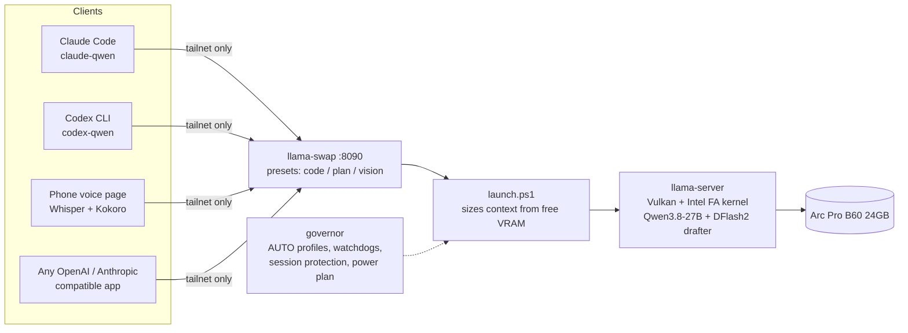

# arc-llm-lab

**Run a 27B coding agent on one Intel Arc Pro B60 24GB.** llama.cpp on Vulkan, 42–45 tok/s generation, a 64K context, and Claude Code and Codex running fully local. Every number below comes with its raw log.

**[Interactive benchmarks →](https://edagher92-coder.github.io/arc-llm-lab/)** hover any data point, replay the speed race, compare GPUs.

<picture>
  <source media="(prefers-color-scheme: dark)" srcset="assets/anim-token-race-dark.svg">
  
</picture>

<picture>
  <source media="(prefers-color-scheme: dark)" srcset="assets/anim-agent-race-dark.svg">
  
</picture>

## Results on a single Arc Pro B60

| | Stock llama.cpp Vulkan | This repo | Raw data |
|---|---|---|---|
| Generation, coding tasks | 16 tok/s | **42.3 tok/s** (peaks 56–60) | [tune.txt](data/raw/tune.txt) |
| Reading new input at 32K context | 118 tok/s | **420 tok/s** | [compare-f16.txt](data/raw/compare-f16.txt) |
| 3 agent turns at 30–37K context | 201 s | **55 s** | [server-test.txt](data/raw/server-test.txt) |
| Context window | — | **64K** with 1.59 GiB VRAM to spare | [vram-budget-64k.csv](data/vram-budget-64k.csv) |
| Coding / tool-call quality checks | — | 7/7 and 3/3 at every setting | [bench-history.csv](data/raw/bench-history.csv) |
| 100-task agent reliability suite | — | [results](docs/RELIABILITY.md) | [evalsuite/](evalsuite/) |

Test PC: Ryzen 7 3700X, B550, 32 GB DDR4, Windows 11, Arc Pro B60 24GB (about A$1,240 at the time of writing).

## Five things every Arc owner should know

1. **Intel's flash-attention prefill kernel makes long-context agents usable, but only with an f16 KV cache.** The kernel comes from llama.cpp [PR #29357](https://github.com/ggml-org/llama.cpp/pull/29357), and this repo ships a portable no-admin build. It reads prompts 3.6× faster at 32K depth. With a q4 KV cache it gains nothing, measured to the decimal. → [docs/INTEL-FA.md](docs/INTEL-FA.md)
2. **Speculative decoding is the biggest single win for generation.** A small DFlash2 draft model takes a 27B dense model from 16 to 42 tok/s with identical output quality. → [docs/TUNING-LOG.md](docs/TUNING-LOG.md)
3. **Keep at least 1.1 GiB of VRAM free.** Below that, generation falls off a cliff (42 → 27 tok/s at the same settings). Turn llama.cpp's auto-fit off; on Windows it quietly spills into shared memory.
4. **`-ub 256` plus a q8 draft KV cache frees 0.55 GiB at no speed cost.** That is the difference between 57K and 64K of context.
5. **Turn off context shift.** By default llama.cpp silently drops old tokens when a conversation overflows. An agent then "forgets" its task with no error. `--no-context-shift` makes the server return an explicit error instead, and the agent wrappers here size their window to server context minus 8K so they compact first.

<picture>
  <source media="(prefers-color-scheme: dark)" srcset="assets/anim-prompt-depth-dark.svg">
  
</picture>

<picture>
  <source media="(prefers-color-scheme: dark)" srcset="assets/speculative-decoding-dark.png">
  
</picture>

<picture>
  <source media="(prefers-color-scheme: dark)" srcset="assets/vram-budget-dark.png">
  
</picture>

## Compared with other cards

How does a A$1,240 Arc card stack up? Specs and prices are sourced; for cards we haven't measured, the generation figure is a clearly labelled **theoretical ceiling** (memory bandwidth ÷ model size), not an invented benchmark. Method: [data/gpu-comparison-notes.md](data/gpu-comparison-notes.md).

<picture>
  <source media="(prefers-color-scheme: dark)" srcset="assets/compare-price-vram-dark.png">
  
</picture>

<picture>
  <source media="(prefers-color-scheme: dark)" srcset="assets/compare-ceiling-dark.png">
  
</picture>

| GPU | VRAM | Bandwidth | AU price | Fits 27B + 32K? | Gen ceiling (est.) | Measured |
|---|---|---|---|---|---|---|
| Arc B580 | 12 GB | 456 GB/s | A$419 | no | — | — |
| Arc A770 16GB | 16 GB | 560 GB/s | A$540 | no | — | — |
| **Arc Pro B60** | **24 GB** | 456 GB/s | **A$1,240** | **yes** | 27.7 tok/s | **16.0 / 42.3 with drafter** |
| RTX 3090 | 24 GB | 936 GB/s | — | yes | 56.9 tok/s | — |
| RX 7900 XTX | 24 GB | 960 GB/s | — | yes | 58.3 tok/s | — |
| RTX 4090 | 24 GB | 1008 GB/s | — | yes | 61.2 tok/s | — |
| RTX 5090 | 32 GB | 1792 GB/s | A$5,999 | yes | 108.9 tok/s | — |

The B60 is the cheapest card in the list that holds a 27B agent with a working context, and speculative decoding takes it past its own bandwidth ceiling. Faster cards would gain from a drafter too, so measured results for them are very welcome: [add your card](../../issues/new?template=benchmark.yml).

## The stack

| Part | What it does | Folder |
|---|---|---|
| Engine | Portable, no-admin build of llama.cpp b11524 plus Intel's FA prefill kernel | [engine/](engine/) |
| Governor | Picks a profile (MAX when you're away, BALANCED while you work, LEAN under load), sizes context to the VRAM actually free, keeps live agent sessions from being shrunk, switches the power plan, restarts anything that dies | [governor/](governor/) |
| Presets | One loaded model, four behaviours chosen by model name: `:code` (no thinking, fast agent turns), `:plan` (16K thinking), `:vision`, default | [llama-swap/](llama-swap/) |
| Agents | Claude Code in "FAST mode" (a 6.6K-token system prompt instead of about 19K) and Codex with a live context window and early compaction | [agents/](agents/), [docs/AGENTS.md](docs/AGENTS.md) |
| Voice | Phone voice assistant: Whisper speech-to-text and Kokoro neural voice, both on CPU, spoken sentence by sentence | [voice/](voice/), [docs/VOICE.md](docs/VOICE.md) |
| Benchmarks | A 55-second regression test, sweep scripts, and every raw log | [bench/](bench/), [data/](data/) |
| Charts and site | Static charts, animated SVGs and the interactive Pages site, all regenerated from the CSVs | [tools/](tools/), [docs/index.html](docs/index.html) |
| Reliability | 100 real tasks with hidden checkers, plus 48–64K sustained-session tests | [evalsuite/](evalsuite/), [docs/RELIABILITY.md](docs/RELIABILITY.md) |
| Operations | `qwen doctor` (26 health checks), `qwen snapshot/rollback` (config history in git), nightly regression run | [governor/](governor/) |

## Quick start (Windows 11)

1. **Driver:** install the current Intel Arc Pro driver.
2. **Engine:** `powershell -ExecutionPolicy Bypass -File engine\build.ps1`. This builds llama.cpp with the Intel FA kernel into `C:\AI\llama.cpp\vulkan-intelfa`. It needs git and Python on PATH, but no Visual Studio or admin rights. Expect 5–20 minutes, mostly the one-time toolchain download.
3. **Models:** Qwen3.8-27B `UD-Q4_K_M` GGUF (and `mmproj-F16` for vision) plus the DFlash2 draft model, in `C:\AI\models\qwen3.8-27b\`.
4. **Server:** put [llama-swap](https://github.com/mostlygeek/llama-swap) in `C:\AI\llama-swap\` with [config.yaml](llama-swap/config.yaml), then copy [governor/](governor/) to `C:\AI\governor\`. Set a key: `setx LOCAL_QWEN_KEY <random string>`.
5. **Check:** `qwen doctor`, then `qwen bench`. Expect about 55 s and 7/7, 3/3.
6. **Agents:** copy [agents/](agents/) wrappers to `%USERPROFILE%\bin` and run `claude-qwen` or `codex-qwen`.

The full walkthrough, including Tailscale remote access and the voice page, is in [docs/SETUP.md](docs/SETUP.md).

## Reliability, not just speed

Fast tokens don't matter if the agent fails the task. [evalsuite/](evalsuite/) has 100 representative tasks across seven categories:

- 20 coding
- 20 debugging
- 15 tool use (git, hashing, test runners)
- 15 file operations
- 10 long-context retrieval
- 10 business maths (GST invoices, payroll overtime, bank reconciliation, aged receivables)
- 10 error recovery

Each task is scored by a hidden checker that the agent never sees. `selftest.py` proves every checker fails an untouched workspace and passes a reference solution. The headline metric is **completed tasks per minute**, not tokens per second. Results and the autonomous / supervised / escalate breakdown are in [docs/RELIABILITY.md](docs/RELIABILITY.md).

## Add your card

Got an A770, B580, B60 or another Intel GPU? Run `qwen bench` or `llama-bench` and [open a benchmark result issue](../../issues/new?template=benchmark.yml). Community results get added to [docs/COMMUNITY-RESULTS.md](docs/COMMUNITY-RESULTS.md) with credit.

## FAQ

**Why not just Ollama or LM Studio?** Both are excellent and both build on llama.cpp. This setup needs things they don't expose: a custom engine build with an unmerged Intel kernel, a speculative draft model, per-request presets on one loaded model, and VRAM-aware context sizing. Any app that supports OpenAI-compatible (`/v1/chat/completions`, `/v1/responses`) or Anthropic-compatible (`/v1/messages`) endpoints can use this server. Ollama's own native API isn't emulated. More in [docs/FAQ.md](docs/FAQ.md).

**SYCL or Vulkan?** For this model on the B60, Vulkan was faster in our testing. We didn't keep the SYCL log, so please submit yours.

**Does it work on Linux?** The engine flags and findings carry over. The governor and wrappers are PowerShell/Windows-first. PRs welcome.

## Credits

- [llama.cpp](https://github.com/ggml-org/llama.cpp), and the Intel engineers behind the FA prefill kernel in [PR #29357](https://github.com/ggml-org/llama.cpp/pull/29357).
- [llama-swap](https://github.com/mostlygeek/llama-swap).
- Qwen models and [Unsloth](https://huggingface.co/unsloth) GGUFs.
- [whisper.cpp](https://github.com/ggml-org/whisper.cpp) and [Kokoro](https://github.com/thewh1teagle/kokoro-onnx).

Built and measured by **Elie Dagher**, with Claude as engineering pair. MIT licensed.

Keywords: Intel Arc Pro B60, Arc B60 24GB, Intel Arc LLM, local LLM on Intel GPU, llama.cpp Vulkan Intel, Vulkan flash attention Intel, 24GB VRAM LLM, Qwen 27B local, local coding agent, Claude Code local model, Codex local model, Ollama alternative Intel Arc, speculative decoding Vulkan, Arc A770 B580 LLM benchmark.
