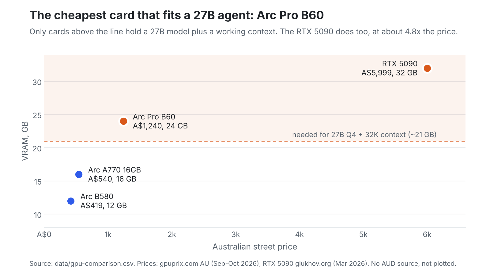
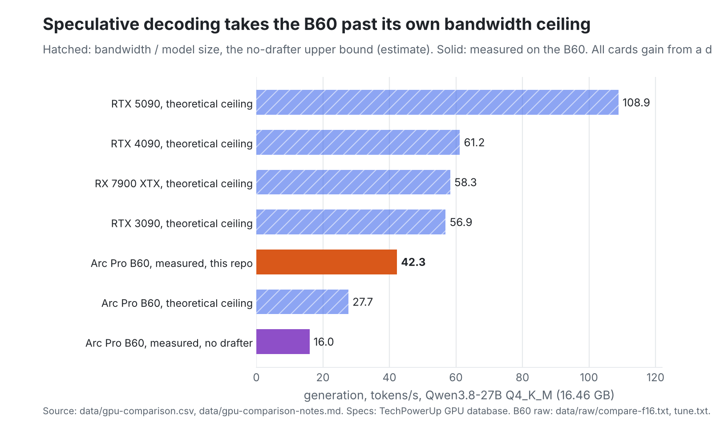
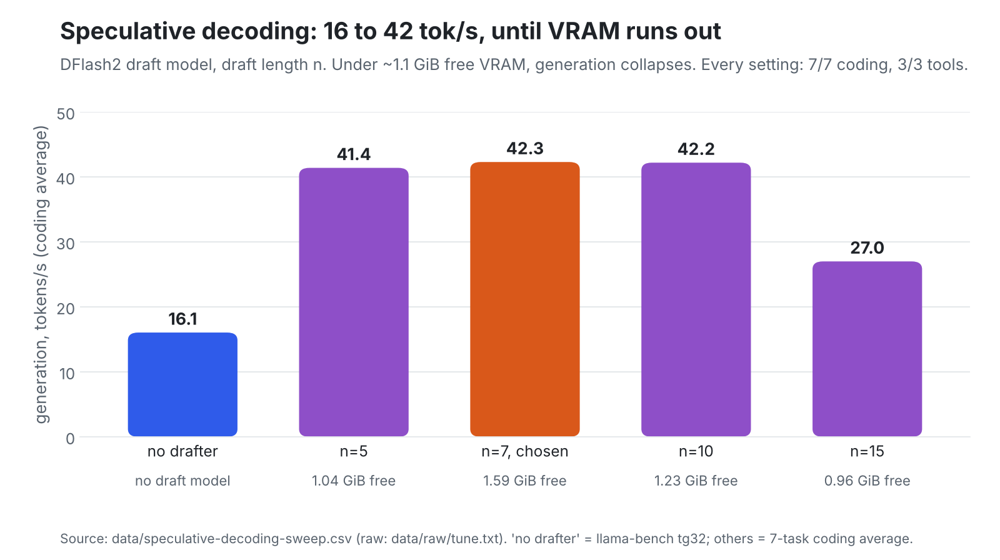
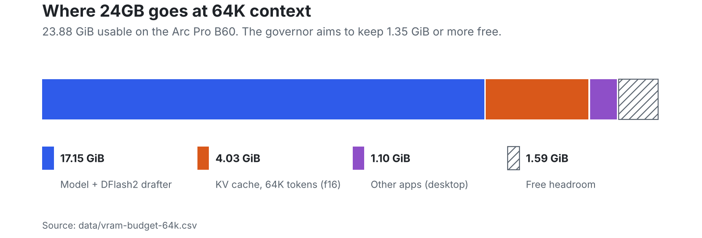
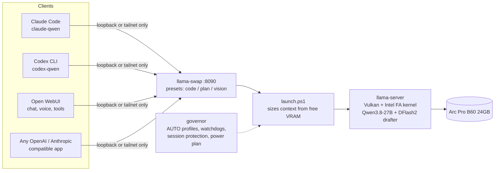

# arc-llm-lab: Qwen 27B on Intel Arc Pro B60 with llama.cpp Vulkan

**Intel Arc Pro B60 24GB · llama.cpp Vulkan · local LLM benchmarks & agent stack**

Run a 27B coding agent fully local on one Intel Arc GPU: tuned llama.cpp (Vulkan), Intel's flash-attention prefill kernel, speculative decoding, Claude Code and Codex wrappers, and a 100-task reliability suite. Measured on an Arc Pro B60 24GB, with the raw logs, the versions and the caveats published.

[](https://github.com/edagher92-coder/arc-llm-lab/actions/workflows/selftest.yml)
[](#which-intel-card-and-which-model-fits)
[](engine/)
[](#versions-used)
[](LICENSE)

**Jump to:** [Results](#results-on-one-arc-pro-b60-24gb) · [Quick start](#quick-start) · [Which card?](#which-intel-card-and-which-model-fits) · [Other B60 results](#how-it-compares-with-other-b60-results) · [Token efficiency](docs/TOKEN-EFFICIENCY.md) · [Tool calling](docs/TOOL-CALLING.md) · [Chat UI, voice and tools](docs/PLATFORM.md) · [Versions](#versions-used) · [FAQ](#faq) · [Add your card](#add-your-card)

## Results on one Arc Pro B60 24GB

| | Stock llama.cpp Vulkan | This repo | Raw data |
|---|---|---|---|
| Generation speed | 16 tok/s ‡ (no drafter) | **42.3 tok/s** ‡ (DFlash2 draft model, n=7; eval-suite throughput, wall-clock) | [compare-f16.txt](data/raw/compare-f16.txt), [tune.txt](data/raw/tune.txt) |
| Reading new input at 32K context | 118 tok/s | **420 tok/s** | [compare-f16.txt](data/raw/compare-f16.txt) |
| 3 agent turns at 30–37K context | 201 s † | **55–57 s** § | [server-test.txt](data/raw/server-test.txt), [bench-history.csv](data/raw/bench-history.csv) |
| Context window | n/a | up to **64K** (57–61K typical while the PC is in use) ¶ | [vram-budget-64k.csv](data/vram-budget-64k.csv) |
| 100-task hidden-checker agent eval, 32K window | n/a | **97/100** Claude Code (1.54 completed tasks/min) · **95/100** Codex · sustained 10-step sessions at 48K/64K: Codex **10/10** and **10/10**, Claude Code **10/10** and **9/10**; single runs, 95% CI 91.5–99% for 97/100 | [RELIABILITY.md](docs/RELIABILITY.md) |

‡ 42.3 tok/s is eval-suite throughput (wall-clock, prompt processing included): generated tokens divided by total wall-clock across the 8 eval requests (7 coding tasks and 1 web page), in the `n7 ub256 dkv-q8` row of [tune.txt](data/raw/tune.txt). The per-request server decode speeds in that run were 47–58 tok/s, mean 53.3. We quote 42.3 as the conservative headline. 16 tok/s is `llama-bench` `tg32` on an empty context with no draft model (16.05 in [compare-f16.txt](data/raw/compare-f16.txt)), a different measurement, so the two are not like-for-like.<br>
† Stock engine with the drafter, observed before logging was in place; the raw log was not retained. Re-run planned. Treat as an observation, not a reproducible measurement ([what we have no raw log for](data/raw/README.md#not-retained)).<br>
§ 54.9 s on the first Intel FA build; 56.7 s on the final tuned configuration at 57,344 context; an intermediate run at 61,440 context took 52.2 s. All three are in the logs ([agent-turns.csv](data/agent-turns.csv)).<br>
¶ 64K (65,536) is the configured maximum and the VRAM budget in the CSV. Context is sized from the VRAM free at each load; the logged runs loaded 61,440 and 57,344 tokens.

All speed figures are single runs (-r 1) unless noted.

Test PC: Ryzen 7 3700X, B550, 32 GB DDR4, Windows 11, Intel Arc Pro B60 24GB. B60 prices in Australia (a snapshot, not a recommendation): A$1,240 for an ASRock B60 Creator ([gpuprix](https://gpuprix.com/australia/gpus/arc-pro-b60), updated 2026-10-07) and A$999 including GST for an ASRock Arc Pro B60 Passive 24GB OEM card (PCCaseGear, 2026-10-10; a passive card has no fan of its own and needs strong airflow).

### Quick start

```powershell
git clone https://github.com/edagher92-coder/arc-llm-lab; cd arc-llm-lab
powershell -ExecutionPolicy Bypass -File engine\build.ps1      # portable, no admin: builds llama.cpp b11524 + the Intel FA patches
```

Then measure your own card with one more command (Windows or Linux, any Vulkan-capable Intel GPU, any GGUF):

```powershell
powershell -ExecutionPolicy Bypass -File bench\arc-bench.ps1 -Model C:\path\model.gguf -VramGb 24 -Contributor "Your Name" -Mmvq
# Linux: bench/arc-bench.sh -m /path/model.gguf --vram-gb 24 --contributor "Your Name" --mmvq
```

The full Windows walkthrough (models, server, agents) is [below](#quick-start-windows-11-in-full) and in [docs/SETUP.md](docs/SETUP.md). On Linux, [engine/build-linux.sh](engine/build-linux.sh) builds the same engine (patch application is verified; the script has not been run end to end on an Arc GPU, so tell us how it goes).

**[Interactive benchmarks →](https://edagher92-coder.github.io/arc-llm-lab/)** hover any data point, replay the speed race, compare GPUs.

<picture>
  <source media="(prefers-color-scheme: dark)" srcset="assets/anim-token-race-dark.svg">
  
</picture>

<picture>
  <source media="(prefers-color-scheme: dark)" srcset="assets/anim-agent-race-dark.svg">
  
</picture>

## Which Intel card, and which model fits?

This repo's measurements are from one card, an Arc Pro B60. The other rows are **specifications plus arithmetic, not benchmarks**: everything marked ESTIMATE is computed from the numbers below, and none of it has been measured on those cards. Sources and method: [data/gpu-comparison-notes.md](data/gpu-comparison-notes.md). Bandwidth is from [data/gpu-comparison.csv](data/gpu-comparison.csv).

The model used here, Qwen3.8-27B `UD-Q4_K_M`, has a 16.46 GB weights file (about 15.3 GiB). The f16 KV cache costs 64.5 KiB per token for this model, which is 2.0 GiB at 32K and 4.0 GiB at 64K. Measured on the B60, the weights plus the DFlash2 drafter and buffers take 17.15 GiB ([vram-budget-64k.csv](data/vram-budget-64k.csv)).

| Card | VRAM | Bandwidth | Qwen3.8-27B Q4_K_M (this repo's model) | Largest GGUF file, rule of thumb (ESTIMATE) |
|---|---|---|---|---|
| Arc Pro B70 | 32 GB | 608 GB/s | **Fits with room to spare** (ESTIMATE). After 17.15 GiB for the model, drafter and buffers and about 1.1 GiB of headroom, roughly 11.5 GiB is left for KV, about 180K tokens of f16 (ESTIMATE; 32 GB = 29.8 GiB). An upstream issue reports instant end-of-sequence beyond about 130K tokens ([llama.cpp #27756](https://github.com/ggml-org/llama.cpp/issues/27756)), so test before relying on it. No-drafter decode ceiling about 36.9 tok/s (ESTIMATE). Not measured here. | about 29 GiB |
| **Arc Pro B60** | **24 GB** | 456 GB/s | **Fits, measured.** 57–64K context, 42.3 tok/s with the drafter, about 16 without. | about 21 GiB |
| Arc A770 16GB | 16 GB | 560 GB/s | No. The weights alone are about 15.3 GiB, which leaves no room for a useful context (ESTIMATE). | about 13 GiB |
| Arc Pro B50 | 16 GB | 224 GB/s | No, for the same reason. It has the lowest bandwidth in this table, so expect the slowest decode per GB of model. | about 13 GiB |
| Arc B580 | 12 GB | 456 GB/s | No. | about 9 GiB |
| Arc B570 | 10 GB | 380 GB/s | No. | about 7 GiB |

**The rule of thumb** is that the model file should be no larger than your VRAM minus about 3 GiB, which leaves room for a short context, buffers and the desktop. Subtract more for long contexts: KV cost per token depends on the model, and the 64.5 KiB figure is for this one only. Check the real file size on the model page before you download. For any model without a draft model, decode speed is roughly bounded by bandwidth divided by file size; for this 27B file that is 27.7 tok/s on a B60 (ESTIMATE), and the draft model is how we got past it.

**Everything else here applies to any Intel Arc card** (the Vulkan flags, the `-ub 256` and q8 draft KV tuning, `--no-context-shift`, the benchmark script). The Intel FA prefill shader was measured only on the B60. B580, B570, B50, B70 and A770 results are the most useful thing you can send us: [bench/arc-bench.ps1](bench/arc-bench.ps1), then the [benchmark form](https://github.com/edagher92-coder/arc-llm-lab/issues/new?template=benchmark.yml) or [Test on my card](https://github.com/edagher92-coder/arc-llm-lab/issues/new?template=test-my-card.yml).

### Compared with cards from other vendors

Specs and prices are sourced; for cards we haven't measured, the generation figure is a clearly labelled **theoretical ceiling** (memory bandwidth divided by file size), not a benchmark.

<picture>
  <source media="(prefers-color-scheme: dark)" srcset="assets/compare-price-vram-dark.png">
  
</picture>

<picture>
  <source media="(prefers-color-scheme: dark)" srcset="assets/compare-ceiling-dark.png">
  
</picture>

| GPU | VRAM | Bandwidth | AU price (dated) | Fits 27B + 32K? | Gen ceiling (ESTIMATE) | Measured |
|---|---|---|---|---|---|---|
| Arc Pro B60 | 24 GB | 456 GB/s | A$1,240 (2026-10-07) | yes | 27.7 tok/s | **about 16, and 42.3 with the drafter** |
| Arc Pro B70 | 32 GB | 608 GB/s | no sourced price | yes | 36.9 tok/s | not measured |
| RTX 3090 | 24 GB | 936 GB/s | no sourced price | yes | 56.9 tok/s | not measured |
| RX 7900 XTX | 24 GB | 960 GB/s | no sourced price | yes | 58.3 tok/s | not measured |
| RTX 4090 | 24 GB | 1008 GB/s | no sourced price | yes | 61.2 tok/s | not measured |
| RTX 5090 | 32 GB | 1792 GB/s | A$5,999 (2026-03) | yes | 108.9 tok/s | not measured |

Smaller Intel cards are in the table above. Faster cards would gain from a drafter too; measured results for them are welcome.

## How it compares with other B60 results

Other people publish Qwen3.8-27B numbers for the same card, so we put them side by side in [docs/PEERS.md](docs/PEERS.md) (data: [peer-benchmarks.csv](data/peer-benchmarks.csv)). The honest summary:

- **Generation:** our 42.3 tok/s is wall-clock eval-suite throughput; peers report decode-only speeds, so the comparable figure is our per-request decode of 47 to 58 tok/s (mean 53.3). On either measure it is above the highest single-B60 figure we found for this model. The closest self-reported figures (41.3 to 41.9 tok/s) use custom quants and a different backend, so they are not like-for-like.
- **Prompt reading:** we are **not** the fastest. Other runs read 589 to 638 tok/s at about 29K with a different llama.cpp engine, and 657 tok/s at 32.8K on OpenVINO, against our 420 tok/s at 32K.
- Methods differ (backend, KV type, drafter, depth, tool), so treat gaps under about 10% as noise.

## Five things every Arc owner should know

1. **Intel's flash-attention prefill kernel makes long-context agents usable, but only with an f16 KV cache.** It reads prompts 3.6× faster at 32K depth (118 to 420 tok/s) and gains nothing with a q4 KV cache (101 versus 101). The kernel comes from llama.cpp [PR #29357](https://github.com/ggml-org/llama.cpp/pull/29357), which its author **closed without merging** on 2026-09-25 and whose branch was later force-pushed. This repo therefore vendors the two commits in [engine/patches/](engine/patches/) with checksums and attribution, and the build applies them to b11524. → [docs/INTEL-FA.md](docs/INTEL-FA.md)
2. **Speculative decoding is the biggest single win for generation.** A small DFlash2 draft model takes a 27B dense model from 16 to 42 tok/s with identical output quality on our seven coding tasks. → [docs/TUNING-LOG.md](docs/TUNING-LOG.md)
3. **Keep a margin of free VRAM (the governor keeps 1.35 to 3 GiB, depending on profile) and turn llama.cpp's auto-fit off.** The one run that fell short (draft length 15, 0.96 GiB free) dropped from 42 to 27 tok/s, but two other runs at 1.04 and 0.71 GiB free did not, so the exact threshold is not established ([details](docs/TUNING-LOG.md)). On Windows auto-fit quietly spills into shared memory.
4. **`-ub 256` plus a q8 draft KV cache frees 0.55 GiB at no speed cost.** That is the difference between 57K and 64K of context.
5. **Make context overflow an error, not a silent loss.** We pass `--no-context-shift` explicitly (it is also the default in b11524), so a conversation that outgrows the server's context gets an HTTP 400 instead of quietly dropping old tokens, and the agent wrappers size their window to server context minus 8K so the client compacts first. Compaction is done by Claude Code or Codex, and a summary can still lose detail; the sustained-session test in [docs/RELIABILITY.md](docs/RELIABILITY.md) checks for that.

<picture>
  <source media="(prefers-color-scheme: dark)" srcset="assets/anim-prompt-depth-dark.svg">
  
</picture>

<picture>
  <source media="(prefers-color-scheme: dark)" srcset="assets/speculative-decoding-dark.png">
  
</picture>

<picture>
  <source media="(prefers-color-scheme: dark)" srcset="assets/vram-budget-dark.png">
  
</picture>

**New to local inference?** [How it works](docs/HOW-IT-WORKS.md) walks through two concept posters, with the corrections that make them match this exact model.

## The stack



| Part | What it does | Folder |
|---|---|---|
| Engine | Portable, no-admin build of llama.cpp b11524 plus Intel's FA prefill kernel (vendored patches with checksums) | [engine/](engine/) |
| Governor | Picks a profile (MAX when you're away, BALANCED while you work, LEAN under load), sizes context to the VRAM actually free, keeps live agent sessions from being shrunk, switches the power plan, restarts anything that dies | [governor/](governor/) |
| Presets | One loaded model, four behaviours chosen by model name: `:code` (no thinking, fast agent turns), `:plan` (16K thinking), `:vision`, default | [llama-swap/](llama-swap/) |
| Agents | Claude Code in "FAST mode" (a compact system prompt, about 6.6K tokens of fixed prefix in total against about 19K for the standard one; the figures were not logged) and Codex, with a live context window and early compaction | [agents/](agents/), [docs/AGENTS.md](docs/AGENTS.md) |
| Token efficiency | The settings that keep the prompt prefix stable and small, what each saves, and how to measure it | [docs/TOKEN-EFFICIENCY.md](docs/TOKEN-EFFICIENCY.md) |
| Tool calling | What tool schemas cost a local model, measured tool-bundle cache behaviour, and the loading rules that follow | [docs/TOOL-CALLING.md](docs/TOOL-CALLING.md) |
| Platform | Open WebUI chat UI, voice in and out, MCP tools and phone access over Tailscale, without disturbing the prompt cache | [docs/PLATFORM.md](docs/PLATFORM.md) |
| Voice | Whisper speech-to-text and Kokoro neural voice, both on CPU, spoken sentence by sentence, with OpenAI-compatible routes | [voice/](voice/), [docs/VOICE.md](docs/VOICE.md) |
| Benchmarks | A regression test (`qwen bench`, about 4 minutes, which includes the three-turn agent test), sweep scripts, the community benchmark script and the raw logs | [bench/](bench/), [data/](data/) |
| Community results | Other people's numbers in one format, with credit | [docs/COMMUNITY-RESULTS.md](docs/COMMUNITY-RESULTS.md) |
| Charts and site | Static charts, animated SVGs and the interactive Pages site, regenerated from the CSVs | [tools/](tools/), [docs/index.html](docs/index.html) |
| Reliability | 100 real tasks with hidden checkers, plus 48–64K sustained-session tests | [evalsuite/](evalsuite/), [docs/RELIABILITY.md](docs/RELIABILITY.md) |
| Operations | `qwen doctor` (26 health checks), `qwen snapshot/rollback` (config history in git), nightly regression run | [governor/](governor/) |

## Quick start (Windows 11), in full

1. **Driver:** install the current Intel Arc Pro driver (we ran 32.0.101.8976, released 2026-09-25).
2. **Engine:** `powershell -ExecutionPolicy Bypass -File engine\build.ps1`. This builds llama.cpp with the Intel FA kernel into `C:\AI\llama.cpp\vulkan-intelfa`. It needs git and Python on PATH, but no Visual Studio or admin rights. Expect 5–20 minutes, mostly the one-time toolchain download (our own log shows 3 min 21 s with the toolchain already in place).
3. **Models:** [Qwen3.8-27B `UD-Q4_K_M`](https://huggingface.co/unsloth/Qwen3.8-27B-GGUF) and `mmproj-F16.gguf` (for vision) from the Unsloth GGUF repository, plus the DFlash2 draft model, in `C:\AI\models\qwen3.8-27b\`. See [Versions used](#versions-used) for the exact files.
4. **Server:** put [llama-swap](https://github.com/mostlygeek/llama-swap) in `C:\AI\llama-swap\` with [config.yaml](llama-swap/config.yaml), then copy [governor/](governor/) to `C:\AI\governor\`. Set a key: `setx LOCAL_QWEN_KEY <random string>`.
5. **Check:** `qwen doctor`, then `qwen bench`. We measured 55–57 s for the three-turn test, with coding 7/7 and tools 3/3.
6. **Agents:** copy the [agents/](agents/) wrappers to `%USERPROFILE%\bin` and run `claude-qwen` or `codex-qwen`.
7. **Optional:** a chat UI with voice and tools: [docs/PLATFORM.md](docs/PLATFORM.md).

The full walkthrough, including Tailscale remote access, is in [docs/SETUP.md](docs/SETUP.md).

## Reliability, not just speed

Fast tokens don't matter if the agent fails the task. [evalsuite/](evalsuite/) has 100 representative tasks across seven categories:

- 20 coding
- 20 debugging
- 15 tool use (git, hashing, test runners)
- 15 file operations
- 10 long-context retrieval
- 10 business maths (GST invoices, payroll overtime, bank reconciliation, aged receivables)
- 10 error recovery

Each task is scored by a hidden checker that the agent never sees. `selftest.py` proves every checker fails an untouched workspace and passes a reference solution. The headline metric is **completed tasks per minute**, not tokens per second. The 97/100 (Claude Code @32K, single run, 95% CI 91.5–99%) and 1.54 tasks/min in the table above are one run at a 32K window, with 0 failures caused by timeouts (one passing task hit the 420 s soft timeout); results, the per-category autonomous / supervised / escalate tiers and the sustained-session tests are in [docs/RELIABILITY.md](docs/RELIABILITY.md).

### Agent safety

Treat a local agent like a fast, fallible junior colleague.

- **One of the 100 tasks ended destructively.** An agent with write access to a project can damage it. Commit or checkpoint before any unattended run, work on a branch or a throwaway copy, and review the diff before you keep anything.
- **Supervise multi-file refactors** and project-wide renames. The per-category tiers in [docs/RELIABILITY.md](docs/RELIABILITY.md) show where the model needed a human and where it didn't.
- **Compaction can lose detail.** Claude Code and Codex summarise long conversations; if a rule matters, put it in a file the agent re-reads rather than in chat.
- Keep the server and the chat UI on loopback or your private tailnet, never on the public internet ([docs/PLATFORM.md](docs/PLATFORM.md#security-summary)).

## Using Ollama or LM Studio?

You can keep using them for smaller models and quick trials. They bundle their own copy of llama.cpp, so they do not include the Intel FA prefill patch or the DFlash2 draft-model path, and this exact setup can't be reproduced inside them. If you want this server's speed from the apps you already use, run llama-server or llama-swap from this repo and point those apps at its OpenAI-compatible (`/v1/chat/completions`, `/v1/responses`) or Anthropic-compatible (`/v1/messages`) endpoint. Ollama's native API is not emulated. A step-by-step guide is one of our [good first issues](docs/GOOD-FIRST-ISSUES.md); more in the [FAQ](docs/FAQ.md).

## Versions used

Everything in the results above was produced with these exact versions, on 2026-10-10.

| Component | Version |
|---|---|
| GPU and driver | Intel Arc Pro B60 24GB, Intel Arc Pro Windows driver 32.0.101.8976 (Intel release 2026-09-25) |
| OS and test PC | Windows 11; Ryzen 7 3700X, B550, 32 GB DDR4 |
| llama.cpp, Intel FA build | build 11526, commit `c85e6c598` (MinGW GNU 16.2.0): upstream b11524 (`86a283532`, tag dated 2026-10-09) plus commits `61cc4c25a6878bfcff2d2d76870ba1948ee0f3e2` and `1a5137a44fe7b2c921fe6b5f7d62704226bac599` ([vendored](engine/patches/)) |
| llama.cpp, stock comparison | b11524 (Clang 20.1.8) |
| llama-swap | v262 (`079c35a`) |
| Claude Code | 2.1.295 |
| Codex CLI | 0.153.4 |
| Python | 3.14.6 |
| Model | [unsloth/Qwen3.8-27B-GGUF](https://huggingface.co/unsloth/Qwen3.8-27B-GGUF), `Qwen3.8-27B-UD-Q4_K_M.gguf` (repository snapshot `4ca720788d1e01f1bff70c033e0d0028fd02e502`) and `mmproj-F16.gguf` |
| Draft model | `Qwen3.8-27B-DFlash2-Q4_K_M.gguf` (we did not record where it was downloaded from; tell us if you know) |
| Architecture | Hybrid: 16 blocks of 3 Gated DeltaNet layers and 1 Gated Attention layer; f16 KV is 64.5 KiB per token |

Server flags and the reasons for each are in [docs/TUNING-LOG.md](docs/TUNING-LOG.md#settings-that-matter-final). Raw logs, an index of what each one shows, and a list of the few figures that have no log are in [data/raw/](data/raw/README.md). The speed table above rests on those logs, with the exceptions marked † and ‡.

## Add your card

Got an A770, B580, B570, B50, B70, B60 or another Intel GPU? Run [bench/arc-bench.ps1](bench/arc-bench.ps1) (Windows) or [bench/arc-bench.sh](bench/arc-bench.sh) (Linux) and [open a benchmark result issue](https://github.com/edagher92-coder/arc-llm-lab/issues/new?template=benchmark.yml). Results go into [docs/COMMUNITY-RESULTS.md](docs/COMMUNITY-RESULTS.md) with credit. Not sure where to start? [Test on my card](https://github.com/edagher92-coder/arc-llm-lab/issues/new?template=test-my-card.yml), or the five [good first issues](docs/GOOD-FIRST-ISSUES.md). Something wrong in this repo? [Report a bug](https://github.com/edagher92-coder/arc-llm-lab/issues/new?template=bug.yml).

## FAQ

**SYCL or Vulkan?** For this model on the B60, Vulkan was faster in our testing. We didn't keep the SYCL log, so that is an observation you can't check; please submit yours. Intel's work on both backends continues upstream ([FAQ](docs/FAQ.md#software-choices)).

**Does it work on Linux?** The engine flags and findings carry over, and there is a build script and a benchmark script for Linux. The governor and agent wrappers are PowerShell and Windows-first. Pull requests welcome.

**What about IPEX-LLM or Intel's llm-scaler?** `intel/ipex-llm` was archived on 2026-01-28. [llm-scaler](https://github.com/intel/llm-scaler) is Intel's vLLM route for Arc Pro cards, aimed at batching and multi-GPU serving; we have not benchmarked it. See the [FAQ](docs/FAQ.md).

## Credits and licence

- [llama.cpp](https://github.com/ggml-org/llama.cpp), and the Intel engineer behind the FA prefill kernel in [PR #29357](https://github.com/ggml-org/llama.cpp/pull/29357); authorship and licence of the vendored patches are in [engine/patches/README.md](engine/patches/README.md).
- [llama-swap](https://github.com/mostlygeek/llama-swap).
- Qwen models and [Unsloth](https://huggingface.co/unsloth) GGUFs.
- [whisper.cpp](https://github.com/ggml-org/whisper.cpp), [Kokoro](https://github.com/thewh1teagle/kokoro-onnx) and [Open WebUI](https://docs.openwebui.com/).

Built and measured by **Elie Dagher**, with Claude as engineering pair. MIT licensed ([LICENSE](LICENSE)). To cite this repository, use [CITATION.cff](CITATION.cff) (GitHub's "Cite this repository" button reads it).

<sub>This repository is about running local LLMs on Intel Arc GPUs (Arc Pro B60, B580, B570, B50, B70 and A770, Battlemage and Xe2) with llama.cpp on Vulkan: 24GB VRAM setups, Qwen 27B coding agents, benchmarks against Ollama and LM Studio, and flash-attention and speculative-decoding results.</sub>
