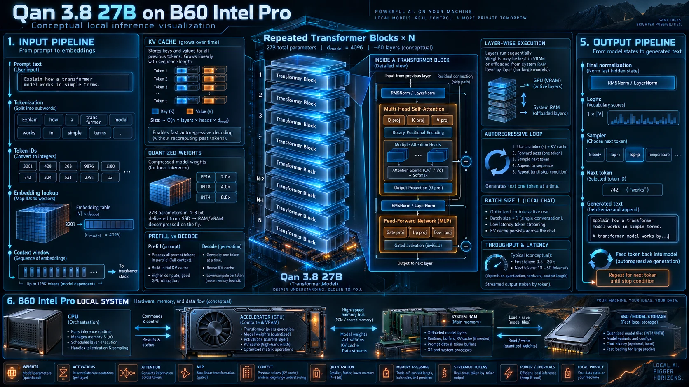
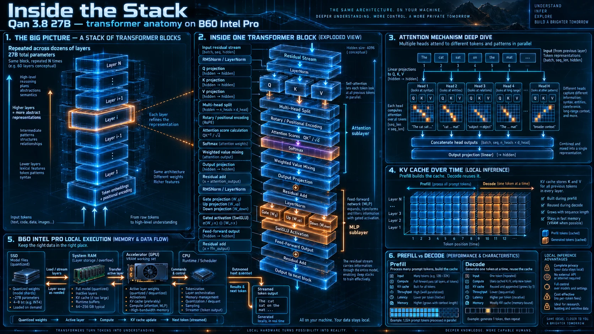

# How a 27B model runs on one Arc Pro B60 (concept art, with corrections)

The two posters below were made by the author as concept art for this project. They explain the general idea of local
transformer inference well: prompt in, tokens out, weights and KV cache in VRAM, prefill versus decode. They are
**illustrations, not diagrams of the exact model**. The table after them lists where Qwen3.8-27B differs, so nothing
here contradicts the measured data in this repo.

## What the posters get right

- **Prefill versus decode.** Reading the prompt is parallel and compute-heavy; writing the answer is one token at a time
  and limited by memory bandwidth. That is why this repo reports prompt speed (420 tok/s at 32K) and generation speed
  (42.3 tok/s eval-suite throughput, 47–58 tok/s per-request decode) separately.
- **The KV cache grows with the conversation** and lives in VRAM next to the weights. It is the reason context length
  is a VRAM budget question (see [vram-budget-64k.csv](../data/vram-budget-64k.csv)).
- **Quantised weights** (4-bit here) are what make a 27B model fit in 24 GB at all.
- **Everything stays on your machine.**

## Where Qwen3.8-27B differs from the generic picture

| Poster shows | Qwen3.8-27B actually has | Why it matters here |
|---|---|---|
| "Qan 3.8" | Qwen3.8 (typo in the artwork) | — |
| ~60 identical attention blocks | 64 layers in 16 groups of 3 Gated DeltaNet + 1 Gated Attention (48 + 16) | Only 16 layers keep a KV cache, so KV costs just 64.5 KiB per token and 64K context fits in about 4 GiB |
| KV cache in every layer | KV cache only in the 16 attention layers; DeltaNet layers carry a fixed-size recurrent state | Prompt reuse works through saved checkpoints of that state, and `--cache-reuse` does nothing on this model |
| Multi-head attention | Gated attention with 4 KV heads × 256 dims (grouped-query) | Small KV per token |
| Layers offloaded to system RAM | All layers on the GPU (`-ngl 99`); RAM holds the prompt cache and the OS file cache | Offloading would cut generation speed sharply |
| "Up to 128K tokens", "10–50 tokens/s" | Up to 64K here (57–61K typical); measured speeds in the [README](../README.md#results-on-one-arc-pro-b60-24gb) | Generic ranges, not measurements |
| One token per decode step | DFlash2 speculative decoding drafts several tokens and verifies them in one pass | The main reason generation went from 16 to 42+ tok/s |

Sources: [Qwen3.8-27B model card](https://huggingface.co/Qwen/Qwen3.8-27B) for the architecture, and this repo's
[data](../data/) for every number.
