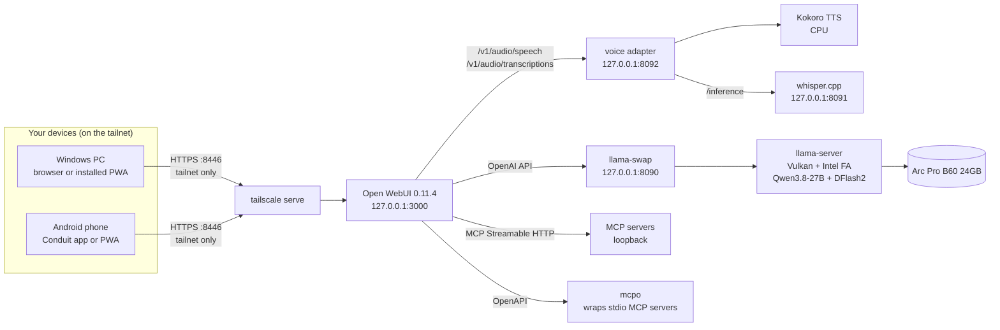

# Platform layer: a private chat UI, voice and tools on the same GPU

The agent stack in this repo already gives you an OpenAI-compatible and Anthropic-compatible server (llama-swap in front of llama-server). This page adds a browser chat UI on top: [Open WebUI](https://docs.openwebui.com/) with voice in and out, MCP tools, and remote access from a phone or another PC over Tailscale. Nothing leaves your network.

Status: this is the setup deployed on the author's PC on 2026-10-10 (Open WebUI 0.11.4, Windows 11). Open WebUI settings and variable names below are from its documentation or were set on that machine. We have not benchmarked the UI; the point of the settings is to keep it from disturbing the model's prompt cache ([TOKEN-EFFICIENCY.md](TOKEN-EFFICIENCY.md)).

## Architecture



| Component | Listens on | Reachable from |
|---|---|---|
| llama-swap and the llama-server backends | `127.0.0.1:8090`, `:10001` and up | this PC only |
| whisper.cpp | `127.0.0.1:8091` | this PC only |
| Voice adapter ([voice/tts_server.py](../voice/tts_server.py)) | `127.0.0.1:8092` | this PC only |
| Open WebUI | `127.0.0.1:3000` | this PC, and the tailnet through `tailscale serve` on **8446** |

Everything is on the loopback interface except the one UI port that Tailscale publishes to your own tailnet. If you also followed the optional API routes in [SETUP.md](SETUP.md) (port 8445), that is a separate, optional exposure.

## 1. Install Open WebUI

Open WebUI 0.11.4 requires Python older than 3.13, so run it with `uv` and a pinned Python 3.11. Set the variables first. Choose a data folder so your chats survive wherever you launch it from (`DATA_DIR` defaults to `./data`).

```powershell
$env:DATA_DIR = 'C:\AI\open-webui'
$env:OPENAI_API_BASE_URL = 'http://127.0.0.1:8090/v1'
$env:OPENAI_API_KEY = $env:LOCAL_QWEN_KEY          # the key llama-swap expects
$env:ENABLE_OLLAMA_API = 'False'
# Background tasks off: see the next section
$env:ENABLE_TITLE_GENERATION = 'False'; $env:ENABLE_TAGS_GENERATION = 'False'; $env:ENABLE_FOLLOW_UP_GENERATION = 'False'
$env:ENABLE_AUTOCOMPLETE_GENERATION = 'False'; $env:ENABLE_RETRIEVAL_QUERY_GENERATION = 'False'; $env:ENABLE_SEARCH_QUERY_GENERATION = 'False'
$env:ENABLE_IMAGE_PROMPT_GENERATION = 'False'; $env:ENABLE_MEMORIES = 'False'; $env:ENABLE_MEMORY_SYSTEM_CONTEXT = 'False'

uvx --python 3.11 open-webui@0.11.4 serve --host 127.0.0.1 --port 3000
```

Open `http://127.0.0.1:3000` and create your account. The first account becomes the administrator. Turn off new sign-ups afterwards (Admin Settings, General), because the UI will be reachable from your tailnet.

**Settings are persistent.** With the default `ENABLE_PERSISTENT_CONFIG=True`, Open WebUI stores most settings in its data folder on first launch and uses the stored values after that, so these environment variables only take effect the first time. Change them later in Admin Settings, or set `ENABLE_PERSISTENT_CONFIG=False` to make the environment win on every start (UI changes are then not saved). To run it at logon, register the `uvx` line as a task through `conhost.exe --headless`, the same way [SETUP.md](SETUP.md) does for llama-swap.

## 2. Keep the prompt cache safe

The model has one slot. Open WebUI normally sends extra background requests after you chat, and each one is a different prompt on that one slot. They queue against your real conversation and can disturb the cached prefix that makes long conversations fast.

| Setting | Background request it stops |
|---|---|
| `ENABLE_TITLE_GENERATION=False` | A request to name the chat after the first reply |
| `ENABLE_TAGS_GENERATION=False` | A request to tag the chat |
| `ENABLE_FOLLOW_UP_GENERATION=False` | Suggested follow-up questions |
| `ENABLE_AUTOCOMPLETE_GENERATION=False` | Autocomplete suggestions while you type |
| `ENABLE_RETRIEVAL_QUERY_GENERATION=False` | An extra request to rewrite the question before document retrieval |
| `ENABLE_SEARCH_QUERY_GENERATION=False` | An extra request to write web-search queries |
| `ENABLE_IMAGE_PROMPT_GENERATION=False` | An extra request to write an image prompt |
| `ENABLE_MEMORIES=False`, `ENABLE_MEMORY_SYSTEM_CONTEXT=False` | Memories injected into the system prompt, which changes the start of every request |
| `ENABLE_OLLAMA_API=False` | Probing for an Ollama server that isn't there |

You lose automatic chat titles. Rename chats by hand; that is the price of a stable cache.

## 3. Connect it to llama-swap

If you set the two `OPENAI_` variables above, the connection exists already. Otherwise add it under Admin Settings, Connections: URL `http://127.0.0.1:8090/v1`, key your `LOCAL_QWEN_KEY`. The model is `qwen3.8-27b`; the presets in [AGENTS.md](AGENTS.md) (`:code`, `:plan`, `:vision`) are model *names* sent in the request. If they don't appear in the model list, add them as custom models (Workspace, Models) with that name; the exact menu wording varies between Open WebUI versions.

## 4. Voice

[voice/tts_server.py](../voice/tts_server.py) is a small adapter that speaks the OpenAI audio API and forwards to the two engines [VOICE.md](VOICE.md) already runs:

| Route | Does |
|---|---|
| `POST /v1/audio/speech` (also `POST /tts`) | JSON `{"input" or "text", "voice", "speed"}` to a WAV from Kokoro |
| `POST /v1/audio/transcriptions` | Forwards the body and `Content-Type` to whisper.cpp `http://127.0.0.1:8091/inference` and returns its JSON |
| `GET /voices` | The six curated voices |

OpenAI voice names map to the nearest curated voice (`alloy` to `heart`, `echo` to `michael`, `fable` to `george`, `onyx` to `lewis`, `nova` to `emma`, `shimmer` to `isabella`); unknown names fall back to `emma`. Start whisper.cpp and the adapter as described in [VOICE.md](VOICE.md), then in Open WebUI Admin Settings, Audio, choose the OpenAI engine for both speech-to-text and text-to-speech and set:

| Field | Value |
|---|---|
| Base URL (both) | `http://127.0.0.1:8092/v1` |
| API key (both) | any non-empty string (the adapter is loopback-only and ignores it) |
| TTS voice | `emma`, or any name above |
| TTS model | any value; it is ignored |

The environment equivalents are `AUDIO_STT_ENGINE`, `AUDIO_STT_OPENAI_API_BASE_URL`, `AUDIO_STT_OPENAI_API_KEY`, `AUDIO_STT_MODEL` and the matching `AUDIO_TTS_*` names. We did not re-verify those against the 0.11.4 documentation, so treat the Admin Settings screen as the authority. The adapter's routes were exercised against a stub whisper server during development; Kokoro synthesis itself is the unchanged code from the earlier voice server.

Browsers only allow microphone access on secure pages, and `tailscale serve` provides HTTPS, so voice input works from your phone over the tailnet.

## 5. Tools through MCP

Two ways, depending on how the tool server runs:

- **Native Streamable HTTP.** Open WebUI can talk to an MCP server that speaks Streamable HTTP directly. Add it under Admin Settings, External Tools.
- **mcpo for stdio servers.** Most MCP servers use stdio. [mcpo](https://github.com/open-webui/mcpo) wraps one as an OpenAPI server that Open WebUI also accepts under External Tools:

  ```powershell
  uvx mcpo --host 127.0.0.1 --port 8100 -- npx -y @upstash/context7-mcp
  ```

  Bind mcpo to loopback explicitly, as above (check its `--help` for the default in your version), and add `http://127.0.0.1:8100` as the tool server.

**Keep the tool list short.** Enabled tools are described to the model in every request. On a 32K to 57K window a large tool set costs real room and prompt-reading time ([TOKEN-EFFICIENCY.md](TOKEN-EFFICIENCY.md)).

## 6. Remote access with Tailscale

Publish only the UI, to your tailnet only:

```powershell
tailscale serve --bg --https=8446 http://127.0.0.1:3000
```

Then browse to `https://<your-machine>.<your-tailnet>.ts.net:8446` from a device signed in to the same tailnet. Do **not** use `tailscale funnel`; that publishes to the public internet. Check what is published at any time with `tailscale serve status`.

| Device | How |
|---|---|
| Windows | Open the address in Edge or Chrome and install it as an app (the PWA) from the browser menu |
| Android | Install the Conduit app (an Open WebUI client), or install the PWA from Chrome. The Tailscale app must be running |

## Security summary

- Every service binds to `127.0.0.1`. The only thing the tailnet can reach is Open WebUI on 8446, and it has its own login.
- Sign-ups are off after you create your account, and there is no Funnel.
- The voice adapter and whisper.cpp have no authentication because nothing outside the PC can reach them. Don't change their bind address.
- The model API key (`LOCAL_QWEN_KEY`) is stored in Open WebUI's connection settings on the PC. Treat the Open WebUI data folder like any folder that holds a key.
- Anyone who can log in to Open WebUI can use your GPU. Add other people only if you mean to.
